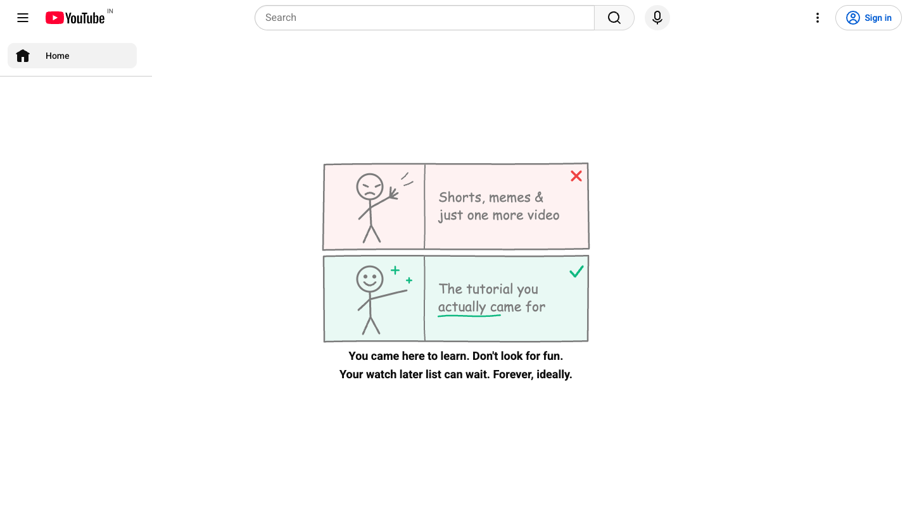
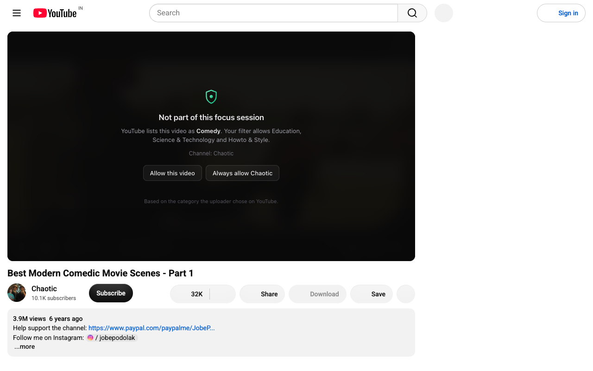
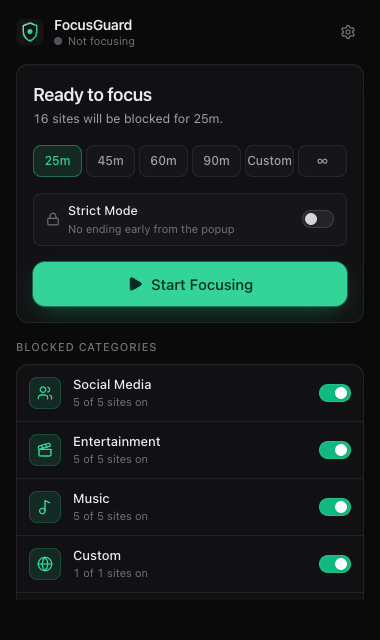
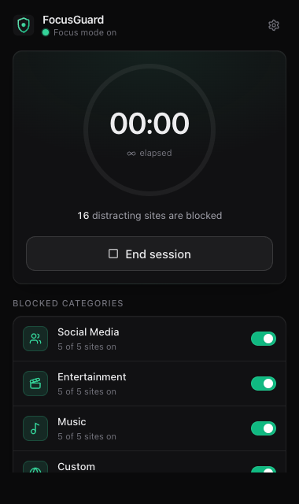
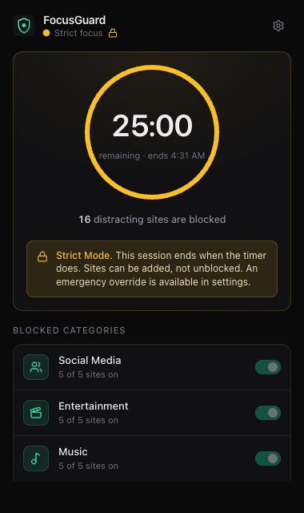

# FocusGuard

A privacy-first focus mode for Chrome. Start a session and FocusGuard blocks distracting websites
(social media, streaming, music, plus anything you add) until the timer ends. You can also keep
YouTube usable for tutorials while its Shorts, feeds and recommendations are hidden.

Built with WXT, React 19, TypeScript (strict), Tailwind CSS v4, Manifest V3 and
`declarativeNetRequest`. Everything runs locally: no accounts, no servers, no analytics.

<p>
  
</p>

<p>
  
</p>

<p>
  
  
  
</p>

## Features

- **Focus sessions:** 25 / 45 / 60 / 90 minutes, a custom length (1–720 min), or no time limit.
  The countdown is computed from stored timestamps, so it stays correct while the popup is closed,
  the browser is minimized, or the service worker is suspended.
- **Reliable blocking:** one `declarativeNetRequest` rule per domain, matched with
  `requestDomains`. Blocking `instagram.com` covers `www.` / `m.` / any subdomain, but never
  `fakeinstagram.com`. Only top-level navigations (`main_frame`) are blocked, so embeds and
  resources on other sites still work.
- **Already-open tabs:** starting a session (or blocking more sites mid-session) reloads open
  tabs on newly blocked sites into Chrome's block page. Unrelated and discarded tabs are left alone.
  Back/forward-cache restores and history-API navigations, which make no network request, are
  caught through `webNavigation` and reloaded into the block.
- **Editable blocklist:** 15 default sites in Social / Entertainment / Music, per-site and
  per-category toggles, and custom domains. Input is normalized: `https://www.instagram.com/x`,
  `www.instagram.com` and `instagram.com` are the same entry.
- **YouTube policy:**
  - *Block YouTube* blocks youtube.com outright.
  - *Clean YouTube* leaves it usable but hides Shorts, the home feed, related videos, comments
    (optional) and autoplay UI, and trims the left menu to just Home. The home feed is replaced
    by a hand-drawn "nope / yep" doodle with a daily quip. YouTube Music is always controlled
    separately.
- **YouTube video filter (Clean YouTube):** only videos in your allowed categories play. By
  default that's Education, Science & Technology and Howto & Style. Any other video is paused and
  covered by an overlay that explains why. Outside Strict Mode, the overlay offers **Allow this
  video** (for the current session) and **Always allow this channel**. The filter uses the
  category each uploader picked on YouTube (e.g. a React talk is *Education*, a comedy
  compilation is *Comedy*). It's a metadata lookup, not AI, and the overlay says so.
- **Strict Mode:** a strict timed session can't be ended from the popup, and sites can't be
  unblocked mid-session (adding more is fine). Settings has an emergency override: type a phrase,
  then hold a button for 5 seconds.
- **Local statistics:** completed sessions and focus minutes for today and in total, plus a
  14-day chart. Days follow your local timezone, and sessions that cross midnight are split.
- **Survives restarts:** state lives in `chrome.storage.local`. On browser startup and on every
  service-worker wake, FocusGuard checks stored state against Chrome. Expired sessions are
  completed, and missing alarms or rules are restored.

## Quick start

Requires Node 20+ and npm.

```bash
npm install
npm run build
```

Load it in Chrome:

1. Open `chrome://extensions`.
2. Turn on **Developer mode** (top right).
3. Click **Load unpacked** and select the `.output/chrome-mv3` folder.
4. Pin FocusGuard from the puzzle-piece menu, then click it to start a session.

### Scripts

| Command | What it does |
| --- | --- |
| `npm run dev` | Launches Chrome with the extension and hot reload |
| `npm run build` | Production build to `.output/chrome-mv3` |
| `npm run zip` | Zips the build for the Chrome Web Store (`.output/focusguard-<version>-chrome.zip`) |
| `npm run store:assets` | Regenerates the store icon, screenshots and promo tiles in `store/images/` (needs network for the YouTube shots) |
| `npm run compile` | Strict TypeScript check (`tsc --noEmit`) |
| `npm test` | Vitest unit tests |
| `npm run test:e2e` | Playwright test against real Chromium with the built extension (run `npm run build` and `npx playwright install chromium` first) |

## Architecture

```
┌──────────── Popup (React) ────────────┐   ┌────────── Options page (React) ──────────┐
│ status · timer · start/end · toggles  │   │ blocklist · YouTube · defaults · stats   │
└───────────────┬───────────────────────┘   └───────────────────┬──────────────────────┘
                │ typed messages (runtime.sendMessage)          │
                │ ◄──── storage.onChanged (read-only) ──────────┤
                ▼                                               ▼
┌──────────────────────── Background service worker ────────────────────────┐
│ focusController: the only writer of state; every operation runs under a  │
│ mutex and re-reads storage first                                         │
│   ├─ ruleManager   → chrome.declarativeNetRequest (dynamic rules)        │
│   ├─ timer/alarms  → chrome.alarms ("focusguard:session-end")            │
│   ├─ tabEnforcer   → chrome.tabs (reload newly-blocked tabs)             │
│   ├─ statistics    → session records + totals                            │
│   └─ storage       → chrome.storage.local (sanitized + migrated)         │
└──────────────────────────────────────────────────────────────────────────┘
                │ storage.onChanged
                ▼
┌──── youtube.content/ (isolated world, www/m.youtube.com) ────┐      ┌─ youtube-bridge (MAIN world) ─┐
│ Clean YouTube <style>; decides each video with              │ ◄─── │ reads the player's public      │
│ youtubeFilter.decideVideo(); shows/hides the overlay        │ DOM  │ metadata: video ID, category,  │
│ ALLOW_VIDEO / ALLOW_CHANNEL → background                    │event │ channel, title                 │
└──────────────────────────────────────────────────────────────┘      └────────────────────────────────┘
```

The YouTube player API (`movie_player.getPlayerResponse()`) is only reachable from the page's own
JavaScript world, so a 2 kB main-world script reads it and passes the data to the isolated
content script as a JSON string on a DOM event. That script validates every field. After
in-page navigation, the player briefly still describes the previous video, so the bridge only
publishes once the reported video ID matches the URL.

**Design rules**

- **The popup doesn't own state.** It can close at any moment, so it only renders storage and
  sends messages. The service worker is the single owner of state changes.
- **Timestamps are the source of truth.** `chrome.alarms` is only a wake-up call, and the session
  ends at `endsAt`. If Chrome was closed past that time, the session is recorded as completed at
  `endsAt` on the next start.
- **Block rules go in first.** Starting a session or changing settings mid-session updates the
  rules first. If Chrome rejects them, the change isn't saved, so the UI never claims protection
  that isn't installed.
- **Rules are idempotent and isolated.** FocusGuard only touches dynamic-rule IDs in
  1,000,000–1,999,999. IDs come from an FNV-1a hash of the domain, so the same domain always gets
  the same ID. Reconciliation diffs installed rules against desired ones and issues a single
  atomic `updateDynamicRules` call, or none when nothing changed.
- **Business logic is framework-free.** `lib/` has no React and talks to Chrome through small
  injected interfaces (`lib/platform.ts` provides the real ones), so it's unit-tested with
  in-memory fakes.

### Project structure

```
entrypoints/
  background.ts           service worker: event listeners → focusController
  youtube.content/        Clean YouTube + video filter content script (index.ts, overlay.ts)
  youtube-bridge.content.ts  MAIN-world reader for the player's video metadata
  popup/                  React popup (index.html, main.tsx, App.tsx)
  options/                React settings page
components/               shared React UI (FocusTimer, DurationSelector, CategoryCard, …)
  ui/                     primitives: Switch, Button, Card, SegmentedControl, Badge, ErrorBanner
hooks/                    useStorageValue, useFocusData, useCountdown, useBackgroundAction
lib/
  focusController.ts      session lifecycle, settings mutations, reconciliation
  ruleManager.ts          DNR rule generation, stable IDs, diff/reconcile
  blockList.ts            settings → block targets (categories, YouTube policy, exclusions)
  domainUtils.ts          normalization + precise domain matching
  siteRegistry.ts         default sites by category
  storage.ts              schema, defaults, sanitizers, migration
  timer.ts                durations, validation, formatting, alarm name
  statistics.ts           local-day aggregation, retention
  tabEnforcer.ts          open-tab enforcement + navigation guard
  youtubeCleaner.ts       Clean YouTube CSS builder
  youtubeFilter.ts        video allow/block decision + Strict Mode loosening check
  youtubeCategories.ts    YouTube's category list and name → ID mapping
  youtubeBridge.ts        validation for metadata crossing from the page world
  messaging.ts            typed request router + client
  platform.ts             real Chrome API adapters
  mutex.ts                promise-chain lock
types/                    focus.ts, settings.ts, messages.ts, classifier.ts (future)
tests/                    Vitest unit tests + in-memory Chrome fakes
e2e/                      Playwright test that loads the built extension
```

## Permissions

| Permission | Why FocusGuard needs it |
| --- | --- |
| `declarativeNetRequest` | Adds and removes the rules that block distracting domains. Chrome enforces them, and FocusGuard never sees your requests. |
| `storage` | Keeps settings, the active session and statistics locally. |
| `alarms` | Ends timed sessions on time even while the service worker is asleep. |
| `tabs` | Reads open tabs' URLs once when a session starts, to reload tabs already on blocked sites. |
| `webNavigation` | Detects back/forward-cache restores and in-page navigations to blocked sites, which make no network request for the block rules to stop. |
| Content scripts on `www.youtube.com`, `m.youtube.com` | Apply Clean YouTube and the video filter. They add a stylesheet and, for a blocked video, an overlay. A small main-world script reads only the current video's ID, category, channel and title from YouTube's player. Nothing leaves the page. |

Chrome summarizes `tabs` and `webNavigation` as "Read your browsing history". FocusGuard only
checks URLs against your blocklist in memory. It never stores or transmits them. It has no
`host_permissions` and doesn't fetch favicons (which would reveal your blocklist to third parties).

## Publishing

`store/listing.md` has every field the Chrome Web Store dashboard asks for: description,
category, single-purpose statement, permission justifications, data-usage disclosures and the
privacy policy URL ([PRIVACY.md](PRIVACY.md)). Upload `.output/focusguard-<version>-chrome.zip`
from `npm run zip` along with the images in `store/images/`.

## Privacy

- All data stays in `chrome.storage.local` on your device. There's no backend, telemetry, or
  account.
- No browsing history is recorded. Session records hold only start/end times, planned length and
  outcome.
- The YouTube scripts read only the current video's ID, category, channel and title, use them to
  decide locally, and keep none of it except channels you choose to always allow. They never read
  comments or other page content, and never send anything anywhere.
- No remote code, no `eval`, no API keys.

## Known limitations

- **Chrome only.** It doesn't block native desktop or mobile apps, other browsers, or other Chrome
  profiles.
- **Incognito** is only covered if you allow FocusGuard in incognito (Extension details → Allow in
  Incognito).
- **Strict Mode is a commitment device, not a lock.** Anyone can disable or remove the extension
  from `chrome://extensions`, and FocusGuard can't (and shouldn't) prevent that.
- **Chrome's built-in block page** ("This page has been blocked by an extension") is used. A
  branded page would need `redirect` rules, which require host permissions for every site.
- **Alarm timing:** Chrome may fire alarms up to ~30 s late. The popup ends the session the moment
  its countdown reaches zero, and stats record the planned end time either way.
- **The video filter is only as good as YouTube's categories.** Uploaders choose them, so a coding
  tutorial filed under *People & Blogs* or *Entertainment* is blocked until you allow the video or
  channel, and a distraction filed under *Education* gets through. If YouTube stops exposing the
  category, the "can't be read" setting decides (default: allow). Up to about 6 seconds may pass
  before that happens.
- **Clean YouTube relies on YouTube's markup.** Selectors are grouped and defensive, so a renamed
  element just stops being hidden and nothing breaks, but YouTube changes can reduce coverage until
  the selectors are updated. Autoplay is handled by hiding its UI and cancelling the "Up next"
  countdown, not by changing your YouTube account setting.
- **Statistics** count timed sessions that ran to the end, and no-limit sessions of at least a
  minute. Early stops and overrides are recorded but not counted. Blocked navigation attempts are
  not measured, so they're not reported.
- **Rule limit:** Chrome allows at most 5,000 dynamic rules (one per blocked domain). Exceeding it
  shows an error and leaves existing rules intact.

## Testing

**Automated**

- `npm test` runs 118 unit tests covering:
  - domain normalization and dedupe
  - rule generation and ID stability
  - category and YouTube behavior
  - session start/end/expiry, Strict Mode and override
  - restart reconciliation
  - concurrent operations and rule-failure rollback
  - local-timezone statistics
  - storage sanitization and migration
  - the Clean YouTube CSS builder
  - video filter decisions, bridge input validation, and Strict Mode filter locking
- `npm run test:e2e` loads `.output/chrome-mv3` into Playwright's Chromium. Hostnames under
  `*.test` resolve to a local server, so no external network is needed. It checks that:
  - a custom domain is blocked along with its subdomains, while lookalike and unrelated sites
    still load
  - an already-open tab is reloaded into the block
  - Instagram and Reddit are blocked
  - ending a session restores access
  - going back to a blocked page is blocked
  - a strict countdown survives closing the popup
  - the emergency override works
- `LIVE_YOUTUBE=1 npm run test:e2e` also runs an opt-in test against the real youtube.com. It
  checks that:
  - a Comedy video is covered and paused, and an Education video plays
  - the filter follows in-page search → click-through navigation
  - the overlay's **Allow this video** button works
  - Strict Mode removes the overlay's buttons

**Manual checklist** (load the unpacked build first):

- [ ] Start Focus Mode → open instagram.com → Chrome's "blocked by an extension" page.
- [ ] End the session → instagram.com loads normally.
- [ ] Open Instagram, then start a session → the Instagram tab reloads into the block.
- [ ] Start a 25-minute session, close the popup, reopen it → the countdown continued correctly.
- [ ] Restart Chrome during a session → still blocked, and the countdown is correct.
- [ ] Start a 1-minute custom session and wait → it ends by itself, and Today shows 1 session.
- [ ] Add `news.ycombinator.com` in settings → blocked during a session. Remove it → loads.
- [ ] Switch YouTube between Block and Clean during a session → youtube.com is blocked / loads
      cleaned. music.youtube.com follows the Music toggle.
- [ ] With Clean YouTube: no Shorts shelf or sidebar entry, no related videos, and the left menu
      shows only Home. The home page shows the centred doodle instead of a feed. A
      `/shorts/<id>` link opens in the normal player. Search and playback work.
- [ ] With Clean YouTube: a tutorial (Education / Science & Technology) plays; a music video or
      comedy clip is paused behind the overlay. **Allow this video** lets it play;
      **Always allow** adds the channel under Settings → YouTube.
- [ ] Strict Mode: no End button in the popup. Switching off a category is disabled. The emergency
      override in settings ends the session.
- [ ] Unrelated sites (docs.python.org, developer.mozilla.org) are never affected.

## Future: content classification

The video filter above handles the common case using YouTube's own categories. The next step is
classifying videos whose category is too vague to judge, such as *People & Blogs* or
*Entertainment*, from their title and description. That isn't built yet, and FocusGuard makes no
claims about it. `types/classifier.ts` defines the contract a future implementation will fill:

- **Input:** minimal public metadata (URL, title, description, platform category). Nothing else
  leaves the page.
- **Output:** `{ category, confidence, allowed, reason, source }`. Low-confidence and `unknown`
  results stay explicit, and allowed categories are user-configurable.
- **Source labelling:** `source` records whether a result came from simple rules or a model.
  Keyword rules are not AI and won't be labelled as such.
- **Cloud models:** any cloud model needs explicit opt-in consent before metadata is shared,
  goes through a backend or user-supplied credentials (never keys embedded in the extension), and
  must account for latency, cost and misclassification. On-device inference is the preferred path.

Other next steps:
- scheduled focus hours and Pomodoro cycles
- daily goals and streaks
- an allowlist for specific educational videos or channels
- import/export of settings
- a keyboard shortcut to start a session
